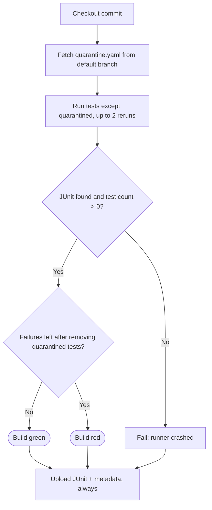
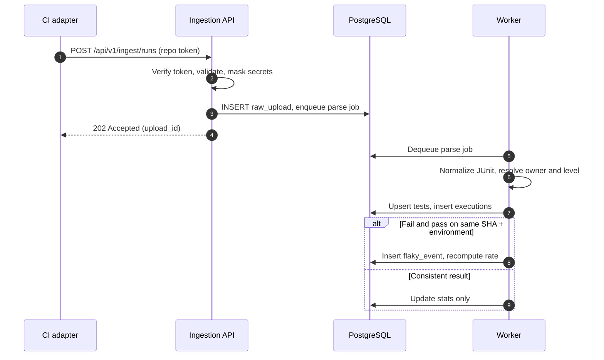
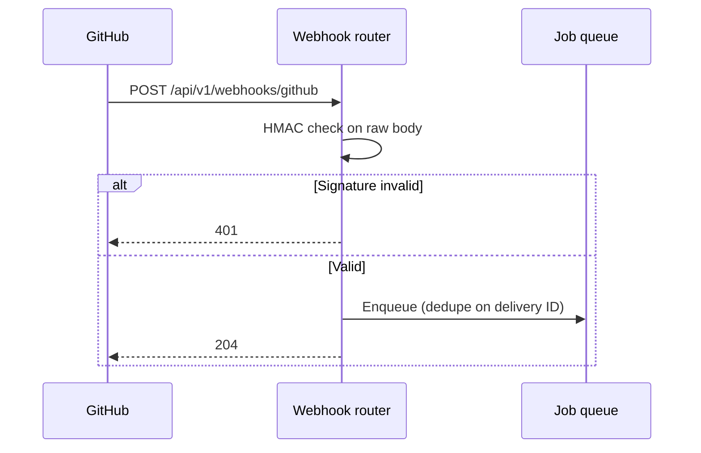
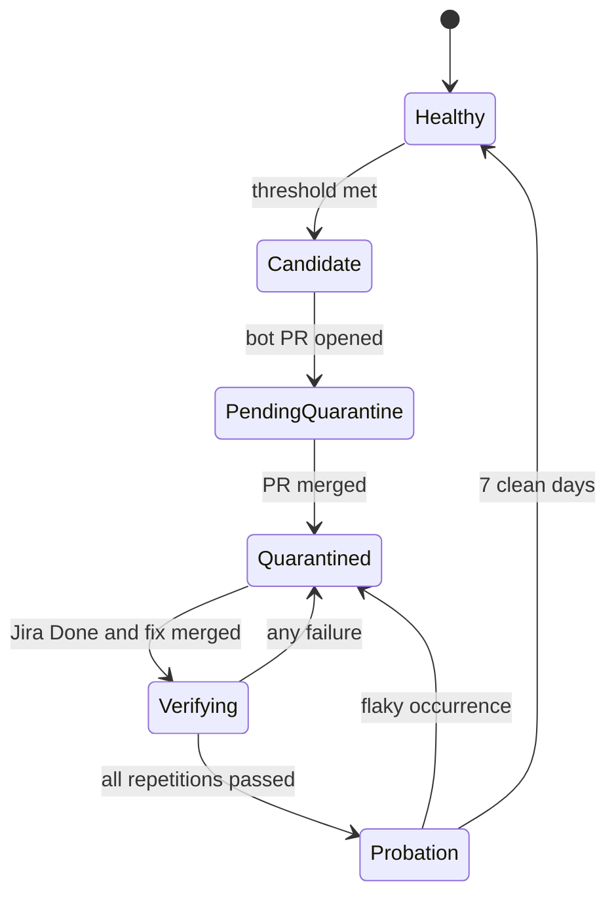
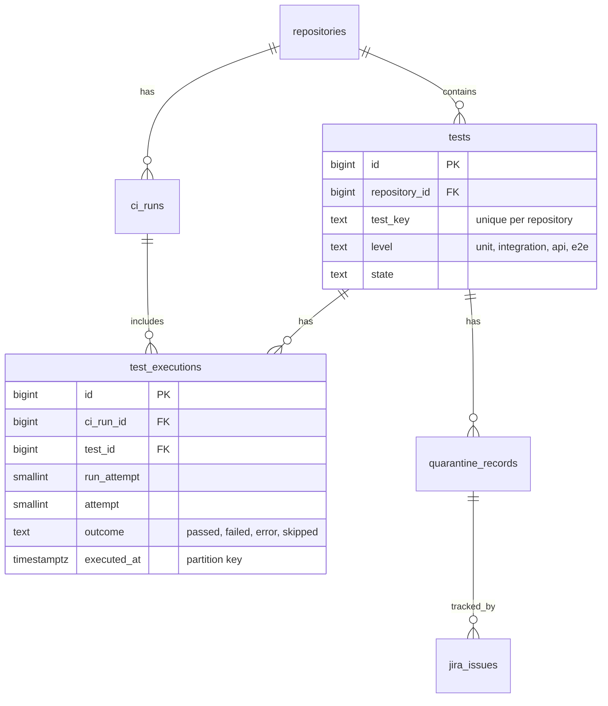
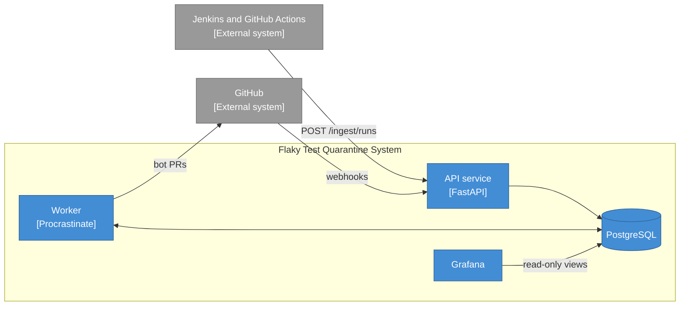
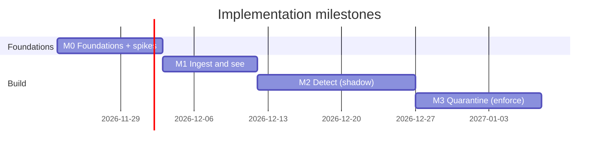

# Mermaid Examples — Flaky Test Quarantine System

Ready-to-use templates in the style of `docs/architecture.md`. Validate with `mmdc -i file.mmd -o file.svg` before committing.

---

## 1. Flowchart — CI pipeline with quarantine gate

## 2. Sequence — ingestion and detection

## 3. Sequence — webhook with signature check

## 4. State diagram — quarantine lifecycle (excerpt)

## 5. ER diagram — core tables (excerpt)

## 6. Flowchart in C4 style — containers

Mermaid's native C4 renderer clips labels at this size; a styled flowchart reads better.

## 7. Gantt — milestone plan

## Tips

- One diagram, one idea. Split a 30-node flowchart into two.
- Label edges with the trigger or data, not "calls".
- Quote labels containing `()`, `:`, `/` or `#`.
- Keep architecture section numbers in the surrounding text so readers can cross-reference.
