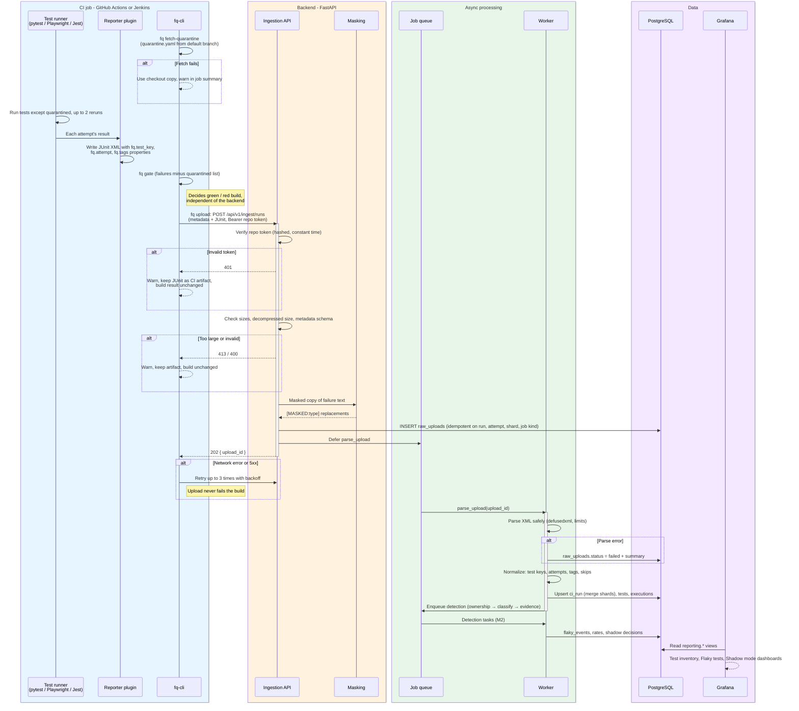
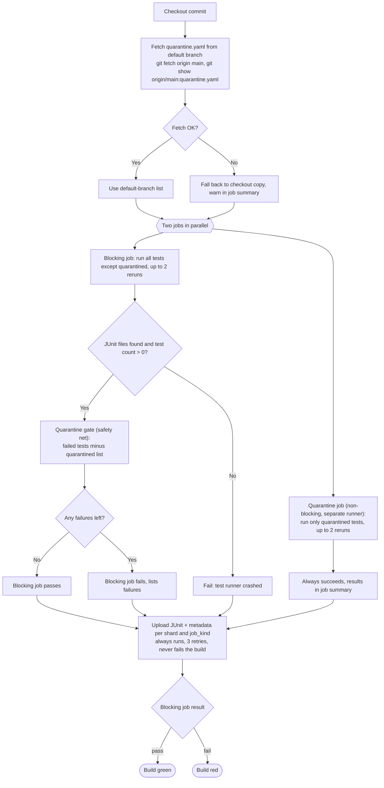
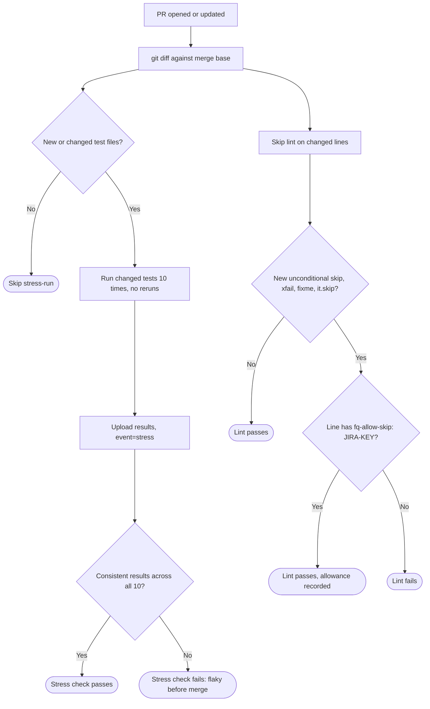
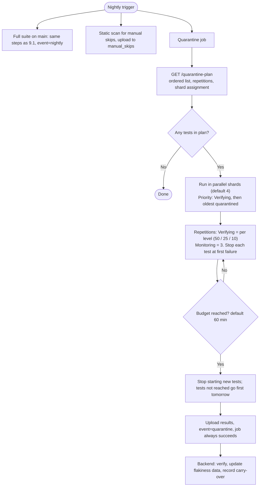

Four flows cover everything CI does with this system. The same steps run on GitHub Actions (reusable workflow) and Jenkins (shared library); only the packaging differs.

<Callout title="Source">
These diagrams come from the design spec ([§9](/engineering/architecture#9-cicd-pipelines)) and the [ingestion flow](/engineering/ingestion-flow). Update them there first.
</Callout>

## Results: CI job to dashboards

What happens to one upload, including every failure path. The build result never depends on the backend.

## Push and PR pipeline

Quarantined tests run in a separate non-blocking job. The gate on the blocking job is a safety net for tests that exclusion missed.

## PR checks: stress-run and skip lint

New or changed tests run 10 times before merge, and new unconditional skips fail the lint check.

## Nightly pipeline

The full suite runs on the default branch, and the quarantine job verifies fixes within a time budget: verifying tests first, then the oldest quarantined.

## Next steps

<Cards>
  <Card title="GitHub Actions" href="/docs/ci-integrations/github-actions">
    Add the reusable workflow to a repository.
  </Card>
  <Card title="Jenkins" href="/docs/ci-integrations/jenkins">
    Use the shared library steps.
  </Card>
  <Card title="Ingestion API" href="/docs/api-reference/ingestion">
    The upload contract.
  </Card>
</Cards>
