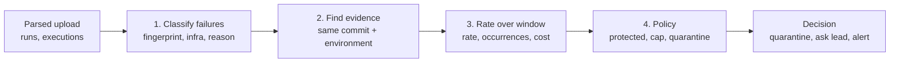

Every decision comes from the same four steps: classify failures, find evidence on the same commit, compute the flakiness rate over a window, and apply the policy. Each step is a pure, tested function, and every threshold comes from configuration.



## 1. Classify failures

Each failure message is masked for secrets, normalized (numbers, IDs, timestamps and paths removed) and hashed into a **fingerprint**. Fingerprints are matched against two rule sets:

- **Infra signatures** — runner out of memory, browser crash, image pull errors. These failures are never evidence.
- **Reason rules** — suggest why the test is flaky: timing, order dependency, concurrency, external dependency, test data, nondeterminism, CI infrastructure, product bug. No match means "untriaged".

A whole run is marked **environmental** when more than 20% of its tests fail (runs of 50 tests or more), or one fingerprint fails 25 or more tests. Nothing from such a run counts as evidence.

## 2. Find evidence

A **flaky occurrence** needs a pass and a fail for the same test on the **same commit and the same environment**:

| Evidence | What happened | Counts? |
| --- | --- | --- |
| Rerun | Failed, then passed on a framework retry in the same job | Yes, on any branch |
| Cross-run | Failed in one run, passed in another (or in "Re-run failed jobs") | Yes, on any branch |
| Different commits | Failed on commit A, passed on commit B | No — the code changed |
| Different environments | Failed on Firefox, passed on Chromium | No — likely a real browser-specific bug |

Each test, commit and environment combination produces at most one occurrence, however many times it's uploaded.

## 3. Rate over a window

```text
flakiness rate = flaky occurrences / execution groups
```

An **execution group** is one test on one commit and environment. The window is whichever holds more groups: the last 14 days or the last 30 groups. A test meets the threshold when the rate is **above 5% and there are at least 2 occurrences**. Repositories with little data can switch to the Wilson lower bound, which asks for more evidence when samples are few.

A **cost score** ranks tests by how much they hurt: failed attempts × median duration, plus 10 minutes for every red build they caused.

## 4. Apply the policy

A test that meets the threshold becomes a **candidate**. The policy then decides, in this order:

1. **Protected?** (listed in the policy file or marked `critical`) → never quarantined; the team is alerted and a high-priority ticket is opened.
2. **Team over its cap?** The team may have at most 5% of its active tests in quarantine, and always at least one. Over the cap → the lead decides.
3. **Otherwise** → quarantined automatically through a bot pull request.

<Callout title="Shadow mode first">
In shadow mode the same decisions are made and recorded, but nothing is sent: no pull requests, tickets or messages. The Shadow mode dashboard shows what would have happened. See [Roll out with shadow mode](/docs/getting-started/shadow-mode-rollout).
</Callout>

## Worked example

`test_create_order[eu]` over the last 14 days:

| Fact | Value |
| --- | --- |
| Execution groups in the 14-day window | 42 (more than the last 30, so the 14 days are used) |
| Flaky occurrences | 3 (2 reruns, 1 cross-run) |
| Rate | 3 ÷ 42 = 7.1% |
| Threshold | above 5% and at least 2 occurrences → **met** |
| Protected | No |
| Team cap | payments: 214 active tests → 10 allowed, 4 in quarantine → under cap |
| Decision | **Quarantine automatically**, suggested reason "timing" |

## Next steps

<Cards>
  <Card title="Flaky evidence" href="/docs/how-detection-works/flaky-evidence">
    Rerun and cross-run evidence in detail.
  </Card>
  <Card title="Quarantine lifecycle" href="/docs/quarantine-lifecycle/states">
    What happens after the decision.
  </Card>
  <Card title="Design spec" href="/engineering/architecture#3-core-concepts">
    The full rules in the architecture document.
  </Card>
</Cards>
