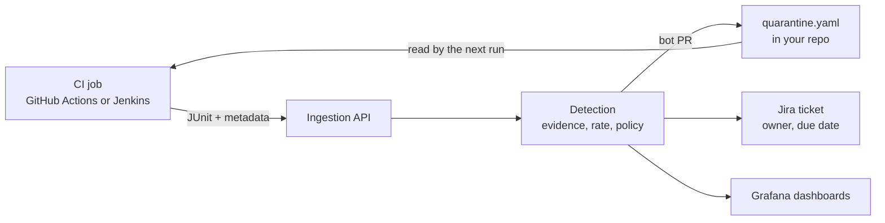

A flaky test passes and fails on the same code. It turns builds red for no reason, teaches people to hit "re-run", and hides real bugs. Most teams deal with it by retrying until green or by skipping the test and forgetting about it.

Flaky Test Quarantine treats it as a process instead. It reads the test results your CI already produces, decides which tests are flaky from evidence on the same commit, takes them out of the blocking path, and keeps them visible until someone fixes them.

## How it works

1. **Your CI uploads results.** A small reporter plugin and the `fq` CLI send JUnit XML and run metadata after every run. An upload never fails a build.
2. **The system looks for evidence.** A test that fails and then passes on the **same commit and environment** is flaky evidence. Failures caused by infrastructure or broken runs are filtered out.
3. **It decides.** When a test's flakiness rate passes the threshold, it is quarantined automatically, unless it's protected or its team already has too many tests in quarantine.
4. **Quarantined tests stop blocking but keep running.** They move to a separate non-blocking CI job, so data keeps coming in.
5. **Someone owns the fix.** Each quarantined test gets a Jira ticket for its team, a due date and a suggested flakiness reason.
6. **It comes back only when proven.** After the fix is merged, the test is re-run many times, released, and watched for 7 more days.

## What's included

<Cards>
  <Card title="Detection" href="/docs/how-detection-works">
    Same-commit evidence, infra filtering, flakiness rate and cost score.
  </Card>
  <Card title="Quarantine lifecycle" href="/docs/quarantine-lifecycle/states">
    Bot PRs, protected tests, team caps, Jira tickets, verification and probation.
  </Card>
  <Card title="CI integrations" href="/docs/ci-integrations/github-actions">
    GitHub Actions and Jenkins, with reporters for pytest, Playwright and Jest.
  </Card>
  <Card title="Dashboards" href="/docs/dashboards/flaky-tests">
    Flaky tests by team, level and reason, shadow-mode decisions and system KPIs.
  </Card>
</Cards>

## Design principles

| Principle | What it means in practice |
| --- | --- |
| CI never waits for this system | Builds read the quarantine list from the default branch in git; the backend is only a fallback when that fetch fails, and a build fails only if both are unavailable |
| Evidence, not guesses | Only the same commit and environment count; infra failures and broken runs are excluded |
| Nothing disappears | Quarantined tests keep running and stay on dashboards until fixed |
| Every test has an owner | Owners come from CODEOWNERS; anything unmatched goes to an "unowned" queue |
| Try before you enforce | Shadow mode shows what would happen, so thresholds can be tuned first |

<Callout title="Project status">
This is a portfolio build designed to scale to a real team's CI. The design is complete; features ship milestone by milestone (M0 to M6). Pages marked "Planned" describe what each milestone will deliver.
</Callout>

## Next steps

<Cards>
  <Card title="Quickstart" href="/docs/getting-started/quickstart">
    Run everything locally with demo data.
  </Card>
  <Card title="How detection works" href="/docs/how-detection-works">
    The rules behind every quarantine decision.
  </Card>
  <Card title="Architecture" href="/docs/architecture">
    Components, data model and flows.
  </Card>
</Cards>
