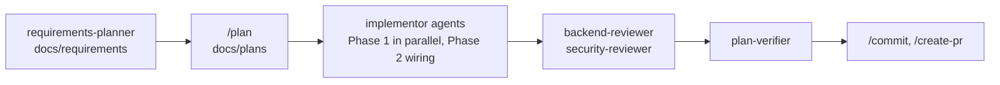

# Agents, skills and commands

The `.claude/` folder holds the AI coding agents, the skills they load and the slash commands used to build this project. Rules every agent follows live in `CLAUDE.md`.

## Agents

| Agent | Use it to |
|-------|-----------|
| `requirements-planner` | Turn a feature or vague issue into a requirements doc checked against `docs/architecture.md` |
| `implementor` | Build one GitHub issue; picks skills by area (backend, fq-cli, plugins, CI adapters, Grafana, UI) |
| `test-writer` | Write deterministic pytest / Vitest tests |
| `backend-reviewer` | Review FastAPI, domain, SQLAlchemy/Alembic, Procrastinate and integration code |
| `security-reviewer` | Review ingestion, webhooks, parsing, credentials, subprocess calls and workflows |
| `plan-verifier` | Check that an issue or plan is fully implemented and its spec covered |
| `refactoring-planner` | Plan a refactoring with characterization tests, safe DB changes and parallel tracks |
| `react-reviewer` | Review the custom UI (M7) |

Reviewers and planners never edit code; they report or write documents.

## Skills

| Skill | Covers |
|-------|--------|
| `backend-best-practices` | Layers, FastAPI, SQLAlchemy/Alembic, Procrastinate, integration clients, logging |
| `backend-testing` | pytest, golden files, hypothesis, transactional Postgres fixtures, fakes, determinism |
| `security` | Threat model, ingestion, webhooks, parsing, credentials, GitHub Actions and Jenkins hardening |
| `git-workflow` | Commits and branches with task IDs (`feat(M1-01): ...`), PR format, push checks |
| `writing-plans` | Step-by-step plans for issues bigger than about a day |
| `brainstorming`, `systematic-debugging`, `mermaid-diagram` | Design sessions, root-cause debugging, diagrams |
| `react-best-practices`, `react-testing-library` | The custom UI (M7) |

## Commands

`/brainstorm`, `/plan`, `/create-branch`, `/commit`, `/create-pr`.

## Token savings and learning with Headroom

Agents in this repo read a lot of noisy output: pytest runs, CI logs, `git diff`, grep results, JSON fixtures. Running sessions through Headroom (`headroom wrap claude`) compresses that output locally so the same work costs fewer tokens. Its log compressor keeps errors, failures, stack traces and summary lines and drops the passing noise, which suits this project's test-heavy sessions.

After each milestone, `headroom learn` reviews failed agent sessions and proposes project facts that would have avoided them (wrong paths, wrong commands, missing setup). They go to `CLAUDE.local.md` first; the useful ones are promoted to `CLAUDE.md` in a PR. Setup and commands: `docs/development-setup.md`.

## Flow for one feature

Example of the whole flow: the M2 detection feature — design in `docs/feature-requirements/`, requirements in `docs/requirements/`, agent plan in `docs/plans/`.
