# Flaky Test Quarantine System: Architecture

Status: v2.5, adds §18 Future improvements (AI failure triage); v2.4 added flips, unclassified level and team cap floor (D36–D38)
Scope: Portfolio/demo build, designed to scale to a real team's CI

---

## 1. Goals and scope

**Goals**

- Detect flaky tests automatically from CI results in Jenkins and GitHub Actions.
- Quarantine flaky tests without blocking delivery. Quarantined tests keep running in a separate job so we keep collecting data.
- Give each flaky test an owner, a Jira bug, a due date and a suggested flakiness reason.
- Release a test from quarantine only after a fix that is merged and verified, followed by a probation period.
- Make flakiness visible by team, product area, test level and reason, and measure whether the system is helping.

**Starting scale**

- 2 repositories, with support for adding more. Works with both monorepos and multiple repos.
- 1 nightly run per repo, plus push/PR runs.
- Frameworks: pytest, Playwright, Jest.

**Out of scope for v1**

- Test impact analysis. "No code change" means the same commit SHA.
- Custom UI. Grafana is used first, but the API and data model are designed so a React UI can be added later without changes.

---

## 2. Decision log

| # | Area | Decision |
|---|------|----------|
| D1 | Detection | Primary signal: same commit SHA + environment produces both fail and pass for a test |
| D2 | Detection | Automatic reruns on failure, at most 2 per test |
| D3 | Detection | Rolling window (last 14 days or last 30 execution groups, whichever has more data). Quarantine needs a rate **> 5% and at least 2 flaky occurrences**. Wilson lower bound is available as a config option |
| D4 | Detection | New or changed tests in a PR are stress-run 10 times |
| D5 | Detection | Infra failures filtered by error signature **and** by mass-failure detection (> 20% of a run's tests failing → environmental run) |
| D6 | Evidence | `rerun` evidence counts on `main` and PRs. `cross_run` evidence counts on any branch when SHA + environment match (this includes "Re-run failed jobs") |
| D7 | Quarantine | Candidates that are not protected are quarantined automatically |
| D8 | Protected tests | Policy file per repo is the source of truth; test markers are a second layer |
| D9 | Cap | At most 5% of a team's tests per repo can be quarantined. Above that, auto-quarantine stops, the lead is alerted, and a human decides. In shadow mode, open "would auto-quarantine" decisions count toward the cap, so shadow numbers match what enforce mode would do |
| D10 | Pipelines | Quarantined tests run in a **separate non-blocking job**. The quarantine gate on the blocking job stays as a safety net |
| D11 | Quarantine list | CI reads `quarantine.yaml` from the **default branch**, and never reads the PR checkout's copy (PR-controlled). If the fetch fails, it uses the backend's last-known-good list (`GET /api/v1/repos/{repo}/quarantine`, 8.1), and fails the job if that is unavailable too. Test selection and the quarantine gate use the same fetched list. Fork PRs have no repo token, so they get only the git path: if the fetch fails there, the job fails rather than trusting the fork's copy |
| D12 | Exit | Jira Done **and** a commit/PR referencing the ticket merged to the default branch → verification (unit/API 50×, integration 25×, e2e 10×) → release → **7-day probation** on `main` |
| D13 | SLA | Due date is 4 days after the ticket is created. When overdue, the team lead gets a Slack message |
| D14 | Max age | After 30 days in quarantine, a forced decision is required: fix, rewrite or delete. Decisions are tracked in the digest |
| D15 | Product bugs | Confirmed reason `product_bug` → linked product Bug with a severity. Whether the test stays blocking is decided case by case |
| D16 | Re-flake | Same failure signature → reopen the old ticket. New signature → new ticket linked to the old one |
| D17 | Ownership | CODEOWNERS → GitHub team → `teams.yaml`. Tests with no CODEOWNERS match go to a QA `unowned` team |
| D18 | Test level | Determined from path conventions and the CI job name, both set in config |
| D19 | Jira | Jira Cloud, one project per team, issue type Bug, label `flaky_test`, project/component default assignee |
| D20 | Notifications | Slack: new quarantine, overdue (DM to lead), flaky protected test (immediate alert), max-age decision, weekly digest |
| D21 | CI | Jenkins shared library and GitHub Actions reusable workflow |
| D22 | Nightly quarantine job | Fixed time budget, run in parallel shards. Priority: Verifying first, then oldest quarantined. Repetitions depend on the test's state; a run stops at the first failure; tests that don't fit carry over to the next night |
| D23 | Storage | PostgreSQL is the source of truth for history and state. A bot PR updates `quarantine.yaml`, auto-merging after checks pass |
| D24 | Ingestion | CI pushes JUnit XML plus metadata to an authenticated API, with one token per repo. Secrets are masked during ingestion |
| D25 | Sharding | Uploads from several shards are merged into one run. A GitHub re-run is the **same run** with a new `run_attempt`, and the attempt is shown |
| D26 | Manual skips | Existing `skip`/`xfail`/`fixme`/`it.skip` are imported and shown separately. A lint check blocks new unconditional skips |
| D27 | Renames | Bot flags quarantine entries that no longer match a test and proposes renames |
| D28 | Rollout | Shadow mode (detection only) for 1–2 weeks before enforcing |
| D29 | Security | GitHub App write access limited to `quarantine.yaml` changes. Secrets masked during ingestion |
| D30 | System metrics | Build-red rate from flaky tests, median time to quarantine, median time to fix, re-flake rate |
| D31 | Retention | Raw results kept 90 days; aggregates kept indefinitely |
| D32 | Inventory | "All tests" means tests seen in the last 30 days; older ones are marked stale |
| D33 | Demo data | 2 demo repos with deliberately flaky tests, plus a history seeder. All demo data is marked and can be deleted with one command |
| D34 | Runtime/stack | Kubernetes in the cloud; Python/FastAPI; Grafana (GitHub OAuth); later a React + TypeScript + Vite UI with TanStack Query/Table and ECharts |
| D35 | Read API auth | Until the custom UI adds GitHub OAuth (M7), the read API requires one service token (`FQ_READ_API_TOKEN`, Bearer). The read API is internal-only, never on the public ingress |
| D36 | Flips | Pass↔fail changes are counted only on the default branch (nightly runs included). Same-commit changes on PRs are already flaky evidence and are not double-counted |
| D37 | Unclassified level | A test matching no level rule is `unclassified`: shown on dashboards, warned about by config sync and listed in the weekly digest, never rejected. Verified with 25 repetitions |
| D38 | Cap floor | The cap counts active tests only (seen in the last 30 days) and always allows at least `team_cap_min_tests` (default 1) quarantined test: allowed = max(5% × active tests, 1) |
| D39 | Bot PR merge | "Auto-merge" means the bot merges its own PR through the REST API once the required check passes. GitHub's native auto-merge is not used: it does not apply the App's ruleset bypass (spike M0-12, `docs/spikes/github-app.md`) |

---

## 3. Core concepts

### 3.1 Test identity

Each test gets a stable key within its repository:

```
{framework}::{file_path}::{test_name}[{params}]
```

Examples:

```
pytest::tests/api/test_orders.py::test_create_order[eu]
playwright::e2e/checkout.spec.ts::Checkout > pays with saved card
jest::src/cart/__tests__/total.test.ts::cart total > applies discount
```

In the database, `(repository_id, test_key)` is unique. In a monorepo, `file_path` already tells tests apart. With multiple repos, `repository_id` does. Renames are handled in section 4.9.

### 3.2 Runs, shards and attempts

- A **CI run** is identified by `(repository, ci_system, run_id)`. Every shard of a run uploads separately, and all uploads are merged into that one run.
- **`run_attempt`** is the CI-level attempt. On GitHub it increases with "Re-run jobs"; on Jenkins it increases with "Replay/Rebuild" of the same build parameters and commit. It's stored on every execution, so dashboards show "run 11893422, attempt 2".
- **`attempt`** is the framework-level rerun inside one execution (1 = first try, 2–3 = reruns).

### 3.3 Execution environment

The CI adapter sets an `environment` string from the job configuration (e.g. `ubuntu-22.04/py3.12` or `ubuntu-22.04/chromium`). A test that fails on Firefox and passes on Chromium is a browser-specific bug, not flaky. That's why detection always groups by SHA + environment.

### 3.4 Flaky occurrence

A **flaky occurrence** is a group of executions of one test with the same `(test, commit_sha, environment)`, where:

- at least one attempt failed and at least one attempt passed,
- the failure is not classified as infra, **and**
- the run it came from is not an environmental run (3.7).

| Evidence | Source | Counts on |
|----------|--------|-----------|
| `rerun` | Fail → pass inside one execution (framework reruns) | Any branch |
| `cross_run` | Fail and pass in different runs or run attempts, same SHA + environment | Any branch |

Same SHA on a PR is as strong as on `main`: the code is identical. A PR that fails on SHA `A` and passes on SHA `B` isn't evidence, because the code changed in between.

### 3.5 Flakiness rate and cost

```
execution_group  = one (test, commit_sha, environment)
flakiness_rate   = flaky_occurrences / execution_groups
window           = whichever has more execution groups:
                   the last 14 days or the last 30 execution groups
quarantine needs : flakiness_rate > 5%  AND  flaky_occurrences >= 2
```

`rate_method` can be set to `wilson`. In that case the 95% Wilson lower bound of the rate must be above 5%, which automatically demands more evidence when there are few samples.

A **cost score** ranks flaky tests by how much they hurt, not just how often they flake:

```
cost_score = (failed attempts in window) × (median duration) + (red builds caused × 10 min)
```

**Flips** (D36) count pass↔fail changes between consecutive executions of a test on the **default branch** only (nightly runs included), per day in `daily_test_stats.flips`. They feed trend panels, not decisions. On PR branches consecutive runs are usually different commits, and same-commit changes are already counted as flaky evidence.

The "Top flaky tests" panel and the max-age decision list both sort by cost.

### 3.6 Failure signature

A failure message is masked for secrets (section 13), then normalized: numbers, UUIDs, timestamps, temp paths and memory addresses are removed. The result is combined with the exception type and hashed into a **fingerprint**. Fingerprints are used to:

- classify failures as infra or not,
- suggest a flakiness reason,
- decide between reopening a ticket and creating a new one.

### 3.7 Environmental runs (mass failure)

If **more than 20%** of the tests in a run fail (applied only when the run has at least 50 tests), or a single fingerprint fails 25 or more tests in one run, the whole run is marked `environmental`. Its failures are stored but not counted as flaky evidence. If more than 10% of a repo's runs in a week are environmental, an alert goes to the QA channel, because that points to a CI infrastructure problem.

---

## 4. Rules

### 4.1 Candidate → quarantine decision

1. A flaky occurrence is recorded → the test becomes a **candidate**.
2. Compute the flakiness rate.
   - Threshold not met (rate ≤ 5% or fewer than 2 occurrences) → state **Watching**. No action; it shows on the dashboard.
   - Threshold met → policy check.
3. Policy check, in order:
   1. **Protected?** (policy file or marker) → never quarantined. Create a high-priority Jira bug and send an immediate Slack alert. The test stays blocking.
   2. **Team over cap?** (quarantined tests + open shadow `auto_quarantine` decisions ≥ allowed, where allowed = max(`team_cap` × active tests, `team_cap_min_tests`) for that team in that repo; active = seen in the last `inventory_stale_days`; D38) → the bot opens a quarantine PR **without auto-merge**, labelled `needs-lead-approval`, with the lead as reviewer, and alerts the lead in Slack. If the lead merges, that's approval. If the PR is closed, the test goes back to Watching.
   3. Otherwise → the bot opens a quarantine PR marked for **auto-merge** (the bot merges it once the required check passes, 9.5; D39), and a Jira ticket is created or reopened.

The bot batches all decisions for a repo from one detection cycle into a single PR. In **shadow mode** (4.12), steps 3.1–3.3 are only recorded as "would have done X".

### 4.2 Flakiness reason classification

Reasons: `timing`, `order_dependency`, `concurrency`, `external_dependency`, `test_data_env`, `nondeterminism`, `ci_infra`, `product_bug`, `untriaged`.

- **Suggested** by rules in `reason_rules.yaml` that map exception types and message patterns to reasons. Examples: `TimeoutError` / `waiting for selector` → `timing`; `ConnectionRefusedError` / `ECONNRESET` → `external_dependency`; `IntegrityError: duplicate key` → `order_dependency`. If no rule matches → `untriaged`.
- The suggestion goes into the ticket as the label `flaky-reason-suggested:<reason>`.
- **Confirmed** by a human in the Jira custom field *Flaky reason*. The field can be set at any time and is required when moving to Done. Every change reaches the backend through the Jira webhook. Setting it to `product_bug` starts the product-bug path (4.7).

### 4.3 Running quarantined tests

- **Blocking job:** runs all tests **except** those listed in the default-branch `quarantine.yaml`.
- **Quarantine job (non-blocking):** runs only the quarantined tests, in a separate process/runner. This keeps any state leakage from a broken test away from healthy tests.
- **Safety net:** the quarantine gate on the blocking job still treats failures of quarantined tests as non-blocking. The gate uses the same fetched list as test selection (D11), never the working-tree `quarantine.yaml`, so a PR can't make its own failures non-blocking by editing that file. This covers cases where exclusion misses a test (ID mismatch, fetch fell back to the backend's last-known-good list, or a test quarantined while the run was in progress).

### 4.4 Exit from quarantine

1. **Two conditions must both hold** before verification starts:
   - the Jira ticket is **Done**, and
   - a commit or PR whose title, branch or message contains the ticket key has been **merged to the default branch** (GitHub `push`/`pull_request` webhook).

   Either one can happen first. The second one to happen moves the test to **Verifying** and records `fix_sha`.
2. The next nightly quarantine job runs the test, at a commit that includes `fix_sha`, a number of times that depends on its level:

   | Level | Repetitions | Catches remaining flakiness of (95% confidence) |
   |-------|-------------|------------------------------------------------|
   | unit, API | 50 | ≥ ~6% |
   | integration | 25 | ≥ ~11% |
   | e2e | 10 | ≥ ~26% |
   | unclassified (D37) | 25 | ≥ ~11% |

3. All runs pass → the bot opens a removal PR with auto-merge → merged → **Probation**. A comment is added to the Jira ticket.
4. Any failure → back to **Quarantined**. The ticket is reopened with the failing run linked, and the due date is reset.
5. **Probation (7 days on `main`):** the test is blocking again, but any flaky occurrence sends it straight back to quarantine. That skips the threshold check, reopens the ticket, and posts to Slack. After 7 clean days → **Healthy** and a release message goes to the team channel.

Probation makes up for the weaker statistical proof that e2e tests get from verification.

### 4.5 SLA

- Due date = creation date + 4 calendar days (configurable: `sla_days`, `sla_calendar: calendar|business`).
- Overdue → one Slack DM to the team lead, and the ticket appears in the weekly digest.
- Reopening a ticket sets a new due date.

### 4.6 Maximum quarantine age

- When a test has been quarantined for **30 days** in total (time across reopenings adds up), it moves to **DecisionRequired**.
- A Jira comment and a Slack DM to the lead ask for a decision in the Jira field *Quarantine decision*:

  | Decision | Effect |
  |----------|--------|
  | `fix` | One 14-day extension. If it's still quarantined after that, the decision is asked for again, and `fix` is no longer allowed |
  | `rewrite` | A new linked "Rewrite test" ticket; the test stays quarantined until the rewritten test replaces it |
  | `delete` | The team deletes the test in a PR. When the test stops appearing in results, the bot removes the entry and closes the ticket |

- Open decisions and those made that week appear in the weekly digest, sorted by cost score.
- Tests on the product-bug path (4.7) are excluded from this rule.

### 4.7 Product-bug path

When the confirmed reason is `product_bug`:

1. The worker creates a linked **product Bug** in the team's Jira project (label `product_bug_from_flaky`, "is caused by" link to the flaky ticket). The team sets its **severity**.
2. The test moves to **ProductBug** state. Its SLA and max age follow the product bug, not the flaky-test rules.
3. Case-by-case decision, recorded on the product bug with the label `keep-blocking`:
   - **Default:** the test stays quarantined (non-blocking) and keeps collecting data as evidence for the bug.
   - **`keep-blocking`:** the bot opens a removal PR. The test blocks again, so the bug can't be ignored. Use this for high-severity bugs.
4. When the product bug is fixed, the normal exit path applies (4.4).

### 4.8 Re-flake handling

When a test that was released becomes a candidate again:

- Fingerprint matches the last closed ticket → **reopen** that ticket.
- Different fingerprint → **new ticket**, linked "relates to" the previous one.
- The re-flake rate (section 12) counts tests re-quarantined within 30 days of release.

### 4.9 Renamed and deleted tests

- **Orphaned entry:** if a test listed in `quarantine.yaml` hasn't appeared in any result for 7 days, the bot marks it orphaned.
- **Rename proposal:** if, in the same commit range, an orphaned test disappeared and a new test first appeared **in the same file**, the bot proposes a rename in a PR. The new key takes over the quarantine entry, the Jira ticket and the history link (`tests.renamed_to_id`). The team approves this PR, because a wrong match would move history to the wrong test.
- **Deleted:** if no rename is found after 7 more days, the bot opens a PR removing the entry and closes the ticket with the resolution "Test deleted".
- The bot PR check (9.5) rejects any `quarantine.yaml` entry that doesn't match a known test, unless it's a pending rename.

### 4.10 Manual skips

- **Import:** tests already skipped by hand are imported into a `manual_skips` table from two sources:
  - JUnit `skipped` results, which carry the skip reason,
  - a static scan of the code in the nightly pipeline (`@pytest.mark.skip`, `xfail`, `test.skip`, `test.fixme`, `it.skip`, `xit`, `describe.skip`).
- **Display:** they're shown on their own dashboard panel, by team and age, and are **not** counted as quarantined.
- **Lint check on PRs:** new **unconditional** skips fail the check. Conditional skips stay allowed, e.g. `skipif(sys.platform == "win32")` or `test.skip(browserName === 'webkit')`, because they're legitimate platform rules. To get around the check, the line needs `# fq-allow-skip: <JIRA-KEY>`, and the allowance is recorded.

### 4.11 Unowned and unclassified tests

Tests whose path has no CODEOWNERS match belong to the `unowned` team, which QA owns in `teams.yaml`. They're ticketed in QA's Jira project and listed on an "Unowned tests" panel. The aim is to keep that panel close to empty by improving CODEOWNERS.

Tests matching no level rule (path or CI job name) get the level `unclassified` (D37). They go through detection like any other test. They are never a reason to reject `teams.yaml`; instead:
- config sync logs a warning with the number of unclassified tests per repo,
- the Test inventory dashboard has an "Unclassified tests" panel,
- the weekly digest lists each team's unclassified tests,
- verification uses `verification_repetitions.unclassified` (default 25).

### 4.12 Rollout: shadow mode

- `mode: shadow` (per repo, in `quarantine-policy.yaml`): detection, scoring and classification run fully. No bot PRs, Jira tickets or Slack messages are sent; the dashboard shows "would have quarantined" decisions instead.
- Each shadow decision is a `quarantine_records` row with `decision = shadow` and a `shadow_outcome` (`auto_quarantine`, `needs_lead_approval`, `protected_alert`). A test has at most one open shadow decision; open `auto_quarantine` decisions count toward the team cap (D9).
- Run for 1–2 weeks. Check false positives, the infra signature list, the mass-failure threshold, and how many tests would be quarantined per team.
- Then switch to `mode: enforce`.

---

## 5. Configuration files

### 5.1 `teams.yaml` (central config repo)

```yaml
version: 1
teams:
  - slug: payments
    github_team: "@acme/payments"
    jira:
      project_key: PAY
      component: "Test Automation"   # its default assignee receives flaky bugs
    slack:
      channel: "#payments-quality"
      lead_user_id: U0123ABCD
    lead_jira_account_id: "5f1c...e2"
    product_areas:
      - name: checkout
        paths:
          shop-web: ["e2e/checkout/**", "src/checkout/**"]
          shop-api: ["tests/api/payments/**"]

  - slug: unowned                    # D17: fallback for tests with no CODEOWNERS match
    github_team: "@acme/qa"
    jira: { project_key: QA, component: "Flaky triage" }
    slack: { channel: "#qa-flaky", lead_user_id: U0456EFGH }

levels:                              # path conventions first, CI job name as fallback; no match → unclassified (D37)
  path_rules:
    - { glob: "**/tests/unit/**",        level: unit }
    - { glob: "**/__tests__/**",         level: unit }
    - { glob: "**/tests/integration/**", level: integration }
    - { glob: "**/tests/api/**",         level: api }
    - { glob: "e2e/**",                  level: e2e }
  job_rules:
    - { pattern: "e2e",         level: e2e }
    - { pattern: "integration", level: integration }

defaults:
  reruns: 2
  flakiness_threshold: 0.05
  min_flaky_occurrences: 2
  rate_method: simple                # simple | wilson
  window_days: 14
  window_min_executions: 30
  team_cap: 0.05
  team_cap_min_tests: 1            # D38: always allow at least this many quarantined tests
  verification_repetitions: { unit: 50, api: 50, integration: 25, e2e: 10, unclassified: 25 }
  probation_days: 7
  sla_days: 4
  sla_calendar: calendar
  max_quarantine_days: 30
  fix_extension_days: 14
  mass_failure: { ratio: 0.20, min_tests: 50, single_fingerprint_tests: 25 }
  orphan_days: 7
  inventory_stale_days: 30
  nightly_quarantine_job:
    budget_minutes: 60
    shards: 4
    monitoring_repetitions: 3
```

### 5.2 `quarantine-policy.yaml` (per repo, QA owns it in CODEOWNERS)

```yaml
version: 1
mode: shadow                 # shadow | enforce
never_quarantine:
  paths:
    - "tests/smoke/**"
    - "e2e/payments/**"
  tests:
    - "pytest::tests/api/test_auth.py::test_login_rejects_bad_password"
  markers: ["critical"]
overrides:
  team_cap: 0.05
```

**Markers (second layer):**

| Framework | How to mark | How it reaches the backend |
|-----------|-------------|----------------------------|
| pytest | `@pytest.mark.critical` | Reporter plugin writes `<property name="tags" value="critical"/>` |
| Playwright | `test('...', { tag: '@critical' }, ...)` | Reporter writes tags as JUnit properties |
| Jest | No native tags: file suffix `*.critical.test.ts`, or `[critical]` in the `describe` title | Normalizer applies the convention |

A test is protected if the policy file **or** a marker says so.

### 5.3 `quarantine.yaml` (per repo, managed by the bot)

```yaml
# Managed by flaky-quarantine-bot. Changes go through bot PRs.
version: 1
tests:
  - id: "pytest::tests/api/test_orders.py::test_create_order[eu]"
    jira: PAY-412
    since: 2026-11-19
    reason_suggested: timing
  - id: "playwright::e2e/checkout.spec.ts::Checkout > pays with saved card"
    jira: PAY-415
    since: 2026-11-20
    reason_suggested: external_dependency
```

---

## 6. High-level architecture (C4)

### 6.1 System context

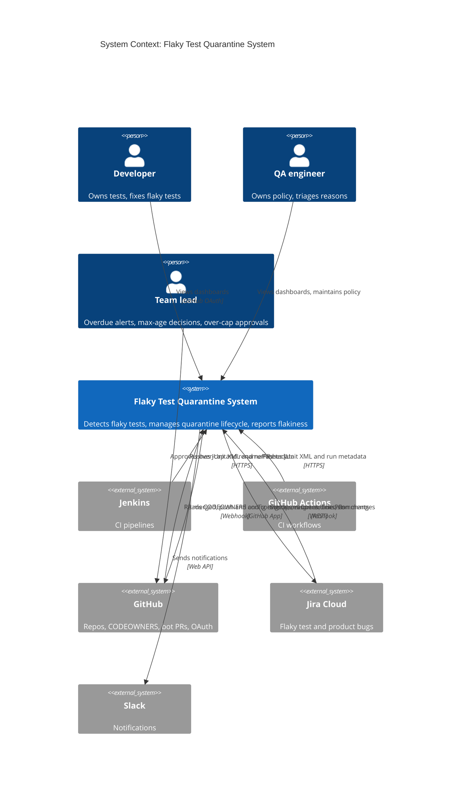

### 6.2 Containers

The diagram uses C4 notation, drawn as a Mermaid flowchart because Mermaid's C4 renderer clips labels at this size.

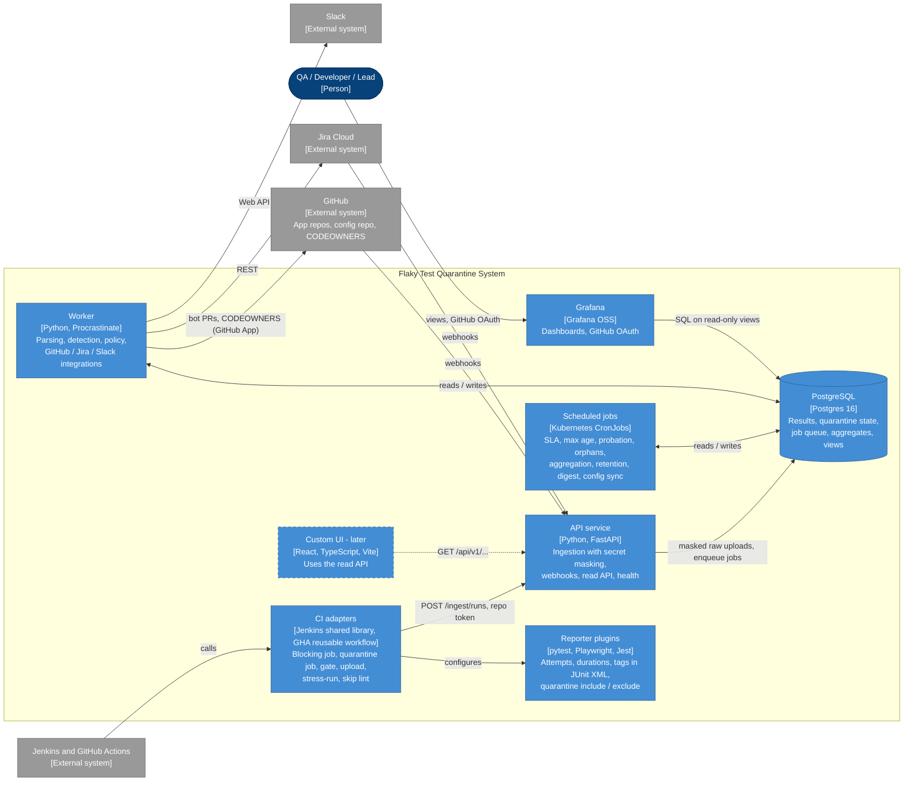

**Why Postgres is also the job queue.** At this scale, a Postgres-backed queue (Procrastinate, `SELECT ... FOR UPDATE SKIP LOCKED`) avoids running Redis. Moving to Redis + ARQ/Celery later only affects the worker container.

---

## 7. Internal service design (C4 Component)

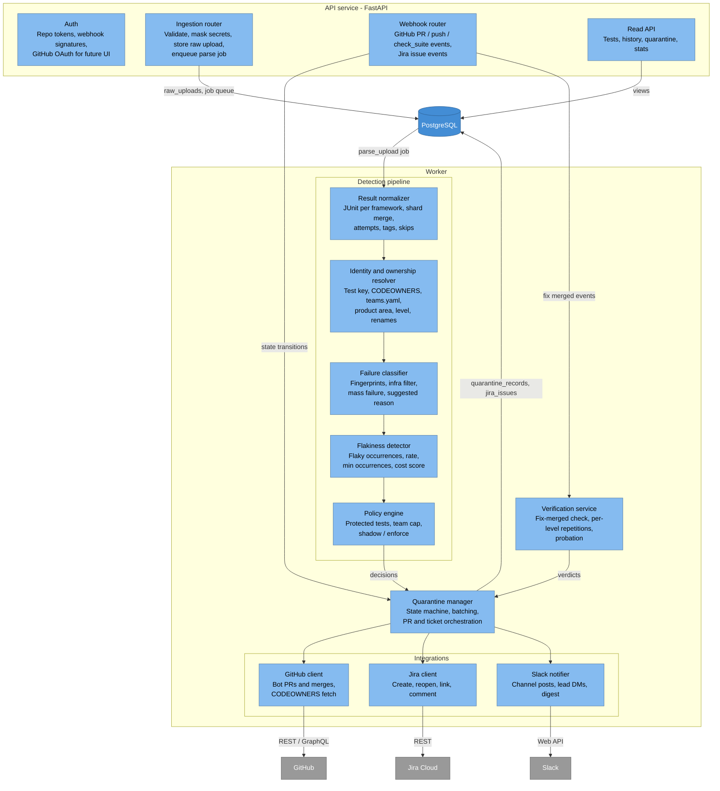

**Code layout (backend):**

```
backend/
  app/
    api/            # routers: ingest, webhooks, read, health
    domain/         # pure logic: identity, fingerprint, masking, detector, policy, state machine
    integrations/   # github, jira, slack clients
    workers/        # job handlers (parse_upload, evaluate_test, open_bot_pr, ...)
    jobs/           # cron entrypoints (sla_check, max_age, probation, orphans, aggregate, retention, digest, config_sync)
    db/             # SQLAlchemy models, views, repositories
    config/         # teams.yaml / policy loaders + pydantic schemas
    admin/          # CLI: seed-demo, purge-demo, backfill
  alembic/
  tests/
```

The domain layer has no I/O, so detection, policy and the state machine can be unit-tested without a database or HTTP.

---

## 8. API

### 8.1 Endpoints

| Method | Path | Auth | Purpose |
|--------|------|------|---------|
| POST | `/api/v1/ingest/runs` | Repo bearer token | Upload JUnit files + run metadata (multipart, one call per shard). Returns `202` with an `upload_id` |
| GET | `/api/v1/ingest/runs/{upload_id}` | Repo token | Processing status |
| GET | `/api/v1/repos/{repo}/quarantine-plan` | Repo token | Nightly job plan: ordered tests, repetitions, shard assignment (9.3) |
| GET | `/api/v1/repos/{repo}/quarantine` | Repo token | Last-known-good quarantine list (D11 fallback). `{repo}` is URL-encoded as one path segment (`acme%2Fshop-web`), as for `quarantine-plan`: the test keys from the default-branch `quarantine.yaml` as last synced by the backend (push webhook or `config_sync`), with the source commit SHA and sync time. Only the token's own repo (`403` otherwise). `fq fetch-quarantine` calls it only when the git fetch fails |
| POST | `/api/v1/webhooks/github` | HMAC signature | `pull_request` closed/merged, `push` to default branch and config repo, `check_suite` completed on bot PRs (auto-merge trigger, 9.5) |
| POST | `/api/v1/webhooks/jira` | Shared secret | `jira:issue_updated` (status, Flaky reason, Quarantine decision, labels) |
| GET | `/api/v1/tests` | Service token (OAuth from M7) | Filter by repo, team, area, level, state |
| GET | `/api/v1/tests/{id}/history` | Service token (OAuth from M7) | Executions by run and attempt, flaky occurrences, quarantine records |
| GET | `/api/v1/quarantine` | Service token (OAuth from M7) | Current quarantine list by state |
| GET | `/api/v1/stats/flakiness` | Service token (OAuth from M7) | Aggregates with `group_by=team,area,level,reason` |
| GET | `/api/v1/stats/system` | Service token (OAuth from M7) | System KPIs (section 12) |
| POST | `/api/v1/quarantine/{test_id}/decision` | OAuth (lead role) | Over-cap and max-age decisions (for the future UI; v1 uses PR review and Jira fields) |
| GET | `/healthz`, `/readyz`, `/metrics` | none / internal | Probes, Prometheus metrics |

### 8.2 Ingestion metadata

```json
{
  "repository": "acme/shop-api",
  "ci_system": "github_actions",
  "pipeline": "ci.yml/test-api",
  "run_id": "11893422",
  "run_attempt": 2,
  "shard": "2/4",
  "job_kind": "blocking",
  "run_url": "https://github.com/acme/shop-api/actions/runs/11893422/attempts/2",
  "commit_sha": "9f2c1e7",
  "branch": "feature/ORD-88-refunds",
  "event": "pull_request",
  "environment": "ubuntu-22.04/py3.12",
  "runner": "gh-hosted",
  "framework": "pytest",
  "started_at": "2026-11-19T21:00:03Z",
  "finished_at": "2026-11-19T21:14:40Z"
}
```

- `event`: `push`, `pull_request`, `nightly`, `quarantine`, `stress`.
- `job_kind`: `blocking`, `quarantine`, `stress`.

**Ingestion responses and limits.** The wire contract is `docs/contracts/ingestion.md` (schema in `docs/contracts/metadata.schema.json`); this section summarizes it.

| Status | Meaning |
|--------|---------|
| `202` | Accepted, or a repeat of an earlier upload's idempotency key (returns the first `upload_id`; differing content is counted and alerted) |
| `400` | `metadata` not the first part, repeated, gzipped or invalid; no `junit` part; too many `junit` parts; invalid gzip |
| `401` | Token authentication problem: missing, malformed or invalid (including revoked or rotated out) |
| `403` | Valid token without permission, e.g. `metadata.repository` differs from the token's repository |
| `413` | A part, the request or a decompressed size is over the limit |
| `429` | Rate limited, with `Retry-After` |

The token is checked before the body is read, and the `metadata` part (first, at most 64 KB) is validated and compared with the token's repository before any `junit` part is read. Malformed XML is not a `400`: the upload ends as `failed` on `GET /ingest/runs/{upload_id}`. `409` is never returned. `upload_id` is a random UUID, never the sequential row id.

Default limits (configurable, proposed in M0-08 and to be confirmed against real uploads in M1-01):

| Limit | Setting | Default |
|-------|---------|---------|
| `metadata` part | `FQ_INGEST_MAX_METADATA_KB` | 64 KB, JSON depth at most 2 |
| One `junit` part, as sent | `FQ_INGEST_MAX_PART_MB` | 20 MB |
| Whole request | `FQ_INGEST_MAX_UPLOAD_MB` | 50 MB |
| One part decompressed | `FQ_INGEST_MAX_PART_DECOMPRESSED_MB` | 100 MB |
| All parts decompressed | `FQ_INGEST_MAX_DECOMPRESSED_MB` | 200 MB |
| `junit` parts per request | `FQ_INGEST_MAX_JUNIT_PARTS` | 20 |
| `POST /ingest/runs` rate | per repo token | 120/min, burst 40 |
| `GET /ingest/runs/{upload_id}` rate | per repo token | 60/min |
| Failed authentication | per source IP (trusted ingress hop only); counts and refuses only bad-token requests | 10/min |

A duplicate upload whose `payload_sha256` (SHA-256 over the masked, decompressed `junit` parts only, not the metadata) differs from the first is still answered `202`, but it increments `raw_uploads.duplicate_mismatches`, is logged and is alerted (section 12).

### 8.3 Sequence: CI run ingestion and detection

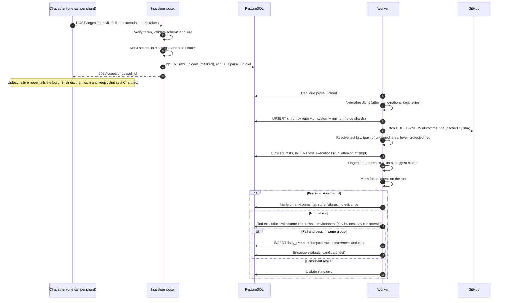

### 8.4 Sequence: quarantine decision, Jira and Slack

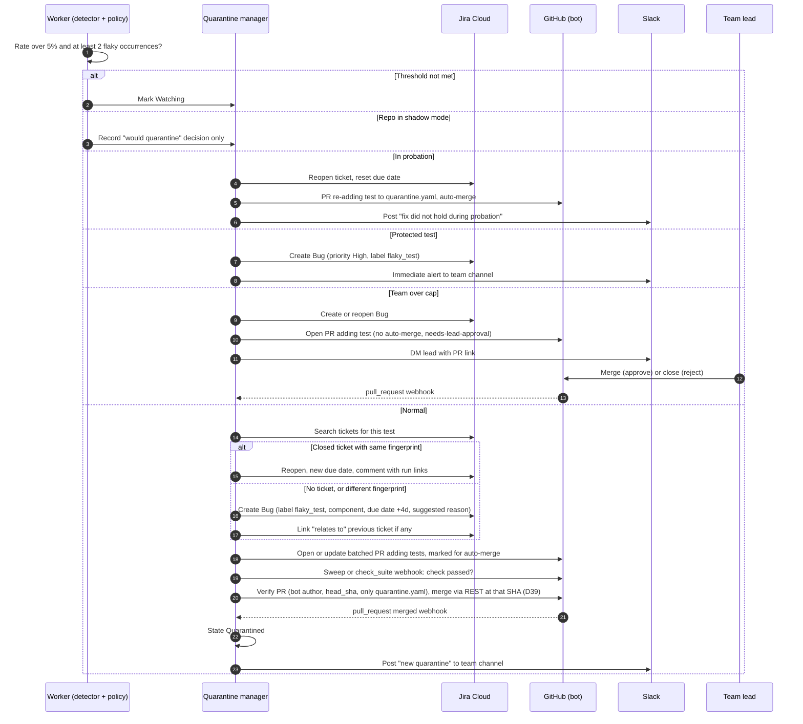

### 8.5 Sequence: fix, verification, release and probation

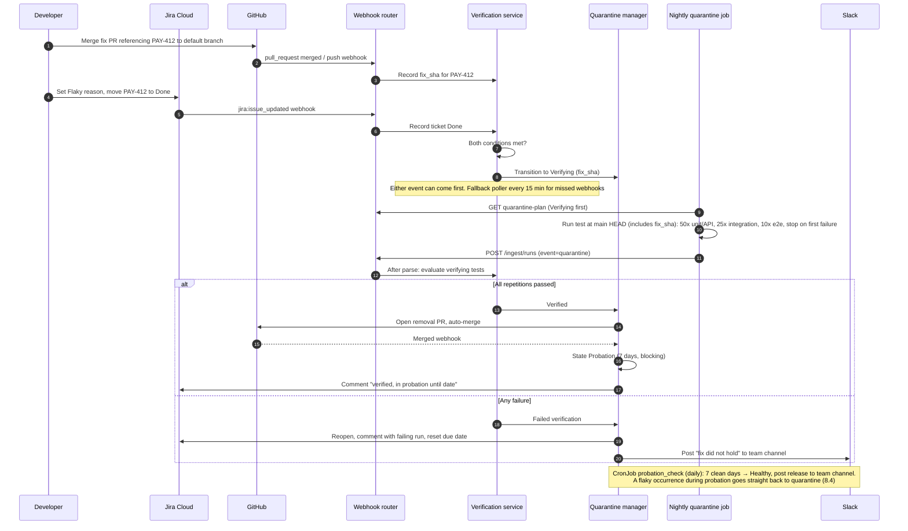

### 8.6 Sequence: SLA, max age and weekly digest

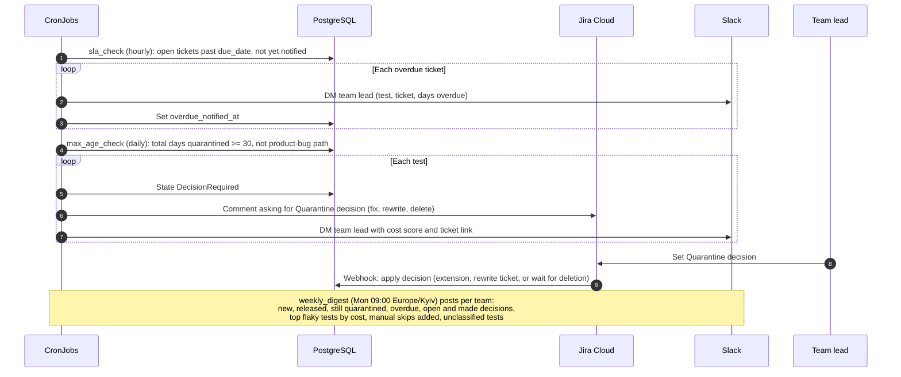

---

## 9. CI/CD pipelines

Both CI systems use the same steps, packaged differently:

- **Jenkins:** shared library steps `flakyFetchQuarantine`, `flakyRunTests`, `flakyGate`, `flakyUpload`, `flakyQuarantineJob`, `flakyStressRun`, `flakySkipLint`.
- **GitHub Actions:** reusable workflow `flaky-quarantine/.github/workflows/test.yml` plus composite actions `flaky-fetch-quarantine`, `flaky-gate`, `flaky-upload`, `flaky-skip-lint`.

Framework settings the adapters and plugins apply:

| | pytest | Playwright | Jest |
|---|--------|------------|------|
| Reruns (max 2) | `--reruns 2` (pytest-rerunfailures) | `retries: 2` | `jest.retryTimes(2, { logErrorsBeforeRetry: true })` |
| Exclude quarantined | Plugin: `--quarantine-file q.yaml --quarantine-mode=exclude` (deselect in `pytest_collection_modifyitems`) | Config reads YAML and builds `grepInvert` from titles | `-t` with a negative-lookahead regex of quarantined names; `--testPathIgnorePatterns` for whole files |
| Only quarantined | Plugin: `--quarantine-mode=only` | `grep` built from titles | `--testPathPattern` + `-t` |
| Repeat N times | `--count=N` (pytest-repeat) + `-x` for stop on first failure | `--repeat-each=N` + `--max-failures=1` per test invocation | Adapter loop over selected tests, stops on first failure |
| JUnit | `--junitxml` + plugin properties | `junit` reporter + custom tags/attempts reporter | `jest-junit` + custom reporter for attempts |
| Sharding | `pytest-split` / `-k` buckets | `--shard=i/n` | `--shard=i/n` |

### 9.1 Push/PR pipeline: blocking job + quarantine job

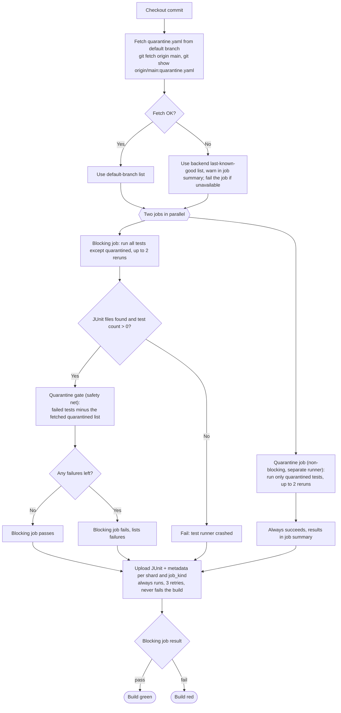

A test that fails and then passes on rerun ends with outcome passed, so the build stays green. The rerun is still uploaded as `rerun` evidence. A "Re-run failed jobs" on the same SHA uploads as the same run with `run_attempt + 1`, which provides `cross_run` evidence.

### 9.2 PR checks: stress-run and skip lint

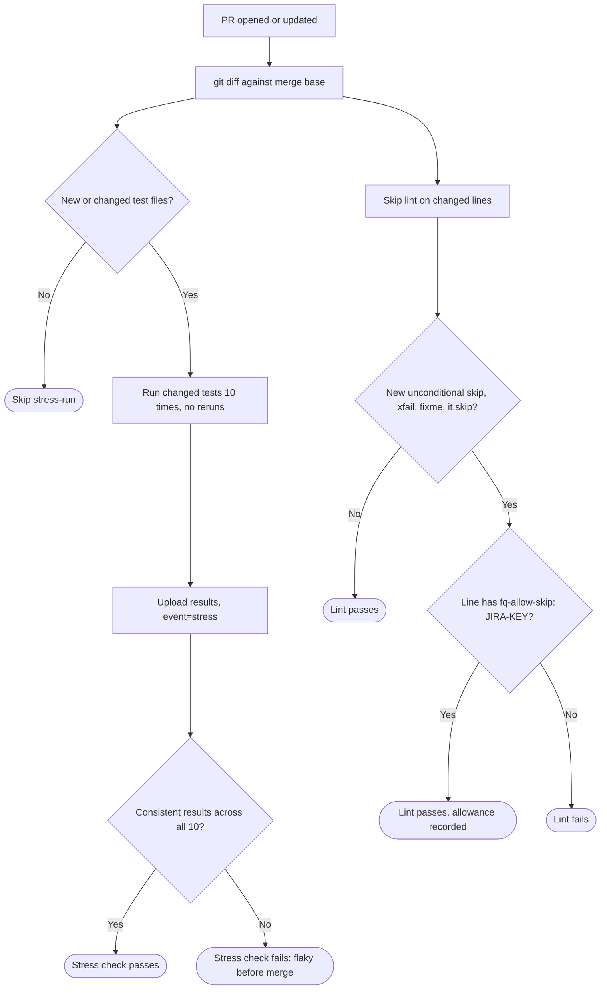

### 9.3 Nightly pipeline: full suite + quarantine job

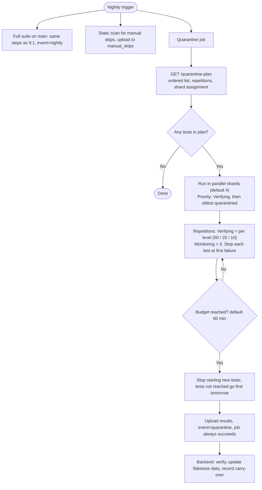

**Time budget strategy:**

The base rule is to run the **oldest-quarantined tests first**. These options are combined with it:

- **Verifying tests go first,** before even the oldest quarantined ones. They decide whether a test can leave quarantine, so they matter most.
- **Parallel shards** (default 4). This saves the most time.
- **Fewer repetitions for tests that are only being monitored.** Tests waiting for a fix only need fresh data, so they run 3 times. Only Verifying tests get the full count per level (50 / 25 / 10).
- **Stop at the first failure.** A test that fails once doesn't need its remaining repetitions. For a Verifying test, one failure already decides the outcome.
- **Plan from historical durations.** The backend estimates each test's run time (median duration × repetitions) from past runs and spreads tests across shards, longest first, so they finish at about the same time.
- **Carry over.** Tests that don't fit tonight's budget run first tomorrow.
- **Not used:** running each monitored test only every other night. Carry-over already covers that case.

Resulting order in the plan: tests carried over from last night → Verifying → quarantined, oldest first.

### 9.4 Jenkins vs GitHub Actions specifics

| Concern | Jenkins | GitHub Actions |
|---------|---------|----------------|
| Non-blocking quarantine job | Parallel stage wrapped in `catchError(buildResult: 'SUCCESS', stageResult: 'UNSTABLE')` | Separate job with `continue-on-error: true` |
| Upload always | `post { always { flakyUpload() } }` | `if: always()` |
| Run attempt | Build number of the replay, with the original build linked as the run | `github.run_attempt` |
| Sharding | Parallel stages | `strategy.matrix.shard` |
| Secrets | Credentials binding for repo token | Repository/organization secret |

### 9.5 Bot PR checks and GitHub App permissions

The required check on bot PRs:

- validates the `quarantine.yaml` schema,
- confirms the PR changes **only** `quarantine.yaml`,
- confirms every entry matches a known test (or a pending rename),
- rejects protected tests,
- rejects entries with no Jira key.

Once the check passes, the bot merges the PR itself (D39):

- **Trigger:** `fq-bot-merge-sweep` (every 5 minutes) checks open bot PRs with `auto_merge` set. A `check_suite` `completed` webhook, if GitHub delivers it to the App for Actions-created suites, only runs the same check sooner. Both paths are idempotent.
- **Pre-merge verification (the bot's own, independent of CI):** the required check runs workflow code taken from the PR head, so anyone who can push to the PR branch could rewrite it. The bot therefore re-fetches the PR and merges only if **all** of these hold:
  - the PR was opened by the App's bot account, from a branch in the same repo;
  - the head SHA equals `bot_pull_requests.head_sha`, the commit the bot itself last pushed. Any other push, by a human or anything else, stops automatic merging; the PR then needs a human review like any other;
  - `GET /pulls/{n}/files` lists exactly one file, `quarantine.yaml`, added or modified, as a regular file;
  - `fq-quarantine-check` succeeded on that head SHA.
- **Merge:** `PUT /repos/{repo}/pulls/{n}/merge`, squash, with `sha` set to that head SHA so a later push cannot be merged unchecked.
- **Why not GitHub auto-merge:** it never applies the App's ruleset bypass, so the PR waits for a review forever (spike M0-12).
- PRs without `auto_merge` (over cap, renames) are never merged by the bot; a human merges them.
- **Stale base:** the check validated the merge with `main` as it was. If `main`'s `quarantine.yaml` changed since, the bot updates its branch (which records a new `head_sha`) and waits for the check again rather than merging.

**Least privilege (D29):**

- The GitHub App is installed only on the target repos, with `contents:write`, `pull_requests:write`, `metadata:read` and `checks:read` (to read check results and receive `check_suite` events). Webhook events: `pull_request`, `push`, `check_suite`. It never gets `workflows`, so the App itself can't edit the check that gates it. Installation tokens are scoped to one repo and to `contents` + `pull_requests` (+ `checks` for the sweep).
- Two repository rulesets on the default branch. **`review`** requires one approving review, with the App as the only bypass actor in `pull_request` mode, so the App can skip review only when merging a PR, never by pushing directly. **`checks`** requires `fq-quarantine-check` from GitHub Actions and has no bypass for anyone. Setup steps and exported ruleset JSON: `docs/spikes/github-app.md`.
- **What keeps the bypass limited to `quarantine.yaml`:** the bot's pre-merge verification above is the primary control. The required check is a second layer that also catches bot bugs, but it can't be the only control, because the workflow it runs comes from the PR. Recommended in M3-01 (to verify): a ruleset on `refs/heads/fq/**` that blocks updates by anyone except the App.
- `contents:write` lets a leaked key push to any branch or tag that isn't protected. Target repos must protect release branches and tags with rulesets the App can't bypass; onboarding checks this.
- The App's private key is in the cloud secret manager and rotated every 90 days.

---

## 10. Database schema (ERD)

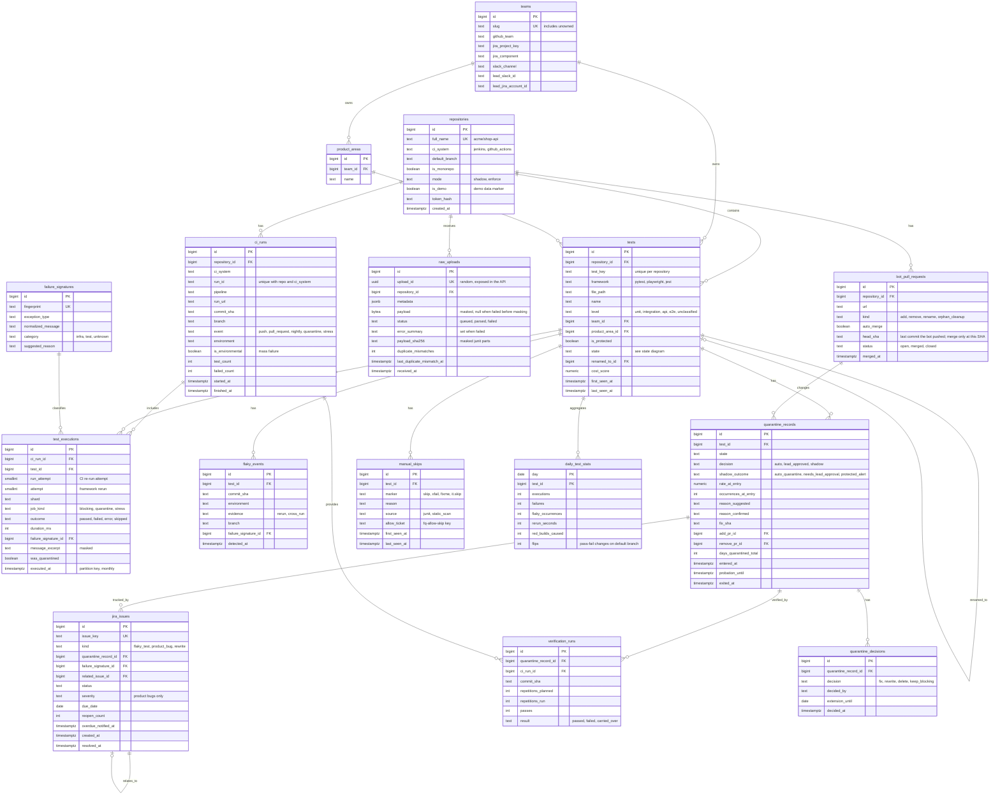

**Indexes for detection (created with schema v1, M0-09):** `ci_runs (repository_id, commit_sha, environment)` for the cross-run evidence lookup, and a unique index on `flaky_events (test_id, commit_sha, environment)` so each execution group produces at most one flaky occurrence.

**Column types (M0-09):** `outcome`, `evidence`, `job_kind` and `event` are Postgres enums; every other value set above is `text` with a `CHECK`, so a new value needs no enum migration. `ci_runs.environment`, `flaky_events.environment` and `raw_uploads.shard` are `''`, not NULL, when unset: NULLs never collide in a unique key or match `environment = :env`. Table and partition details are in `docs/db.md`.

**Retention (D31):** `test_executions` is partitioned by month, and partitions older than 90 days are dropped. `raw_uploads` and `flaky_events` are purged after 90 days. All other tables are kept indefinitely. A daily `retention` CronJob does the cleanup.

**Demo data (D33):** every row belongs, directly or through foreign keys, to a repository. Demo repositories have `is_demo = true`, and foreign keys use `ON DELETE CASCADE`, so deleting the demo repositories removes all their data (section 15).

**Grafana contract:** Grafana reads only from SQL views through a read-only role:

- `v_test_inventory`
- `v_flaky_tests`
- `v_quarantine`
- `v_flakiness_daily`
- `v_rerun_cost`
- `v_manual_skips`
- `v_system_kpis`
- `v_shadow_decisions`
- `v_environmental_runs` (runs, environmental runs and ratio per repo per ISO week)

The future custom UI's read API queries the same views, so both front ends share one data contract.

---

## 11. Quarantine lifecycle (state diagram)

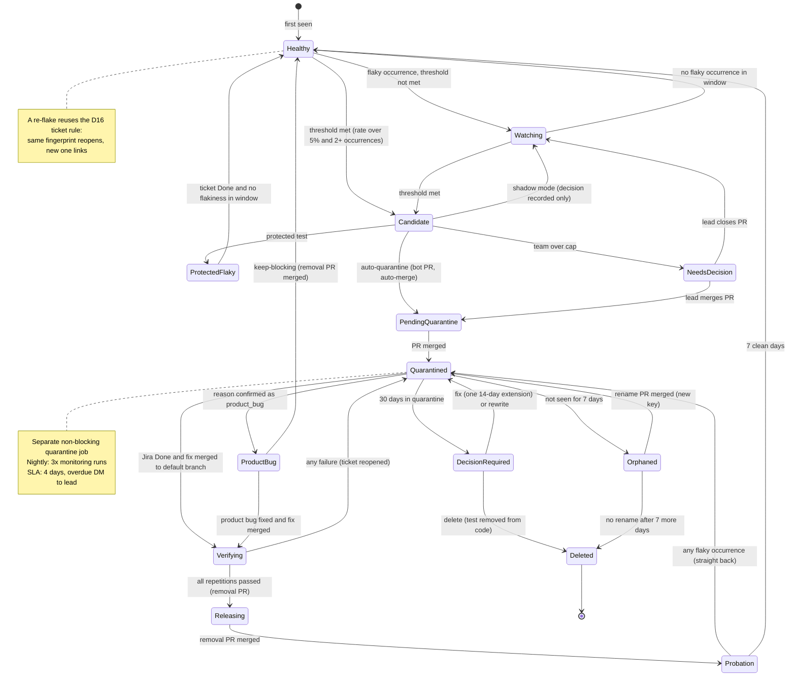

---

## 12. Dashboards (Grafana) and system metrics

Global variables: `repo`, `team`, `product_area`, `level`, `framework`, `reason`, `time range`. A `data` variable (`real` / `demo` / `all`, default `real`) filters on `repositories.is_demo`. When demo data is shown, every dashboard displays a "DEMO DATA" banner.

| Dashboard | Panels |
|-----------|--------|
| **Overview** | Active tests, quarantined count, protected-flaky count, overdue tickets, decisions required, flakiness rate trend, quarantined % per team vs 5% cap |
| **Test inventory** | All tests run in CI (last 30 days) by level; grouped by team → product area; stale tests; **unowned tests**; **unclassified tests** |
| **Flaky tests** | Flaky tests by level; by reason (suggested vs confirmed) with product area label; **top 10 by cost score**; flaky by environment; environmental runs per repo |
| **Quarantine & SLA** | Current quarantine list (test, team, area, Jira, due date, days quarantined, state); overdue; DecisionRequired list; probation list; product-bug path; average time in quarantine; orphaned entries |
| **Manual skips** | Skips by team, marker and age; new skips this week; allowances by ticket |
| **CI cost** | CI minutes on reruns by repo/team/level; nightly quarantine job duration vs budget; carry-over count |
| **Test drill-down** | One test: timeline by run and run attempt (outcome per attempt), flaky events, signatures, quarantine records, decisions, Jira tickets, CI links |
| **Shadow mode** | "Would have quarantined" decisions per team, compared with what enforce mode would produce |
| **System KPIs** | See below |

**System KPIs (D30):**

| KPI | Definition |
|-----|------------|
| Build-red rate from flaky tests | Red blocking builds where every failure is from a test later confirmed flaky, divided by all blocking builds, per week |
| Median time to quarantine | From the first flaky occurrence to the quarantine PR being merged |
| Median time to fix | From quarantined to Probation |
| Re-flake rate | Tests re-quarantined within 30 days of release, divided by tests released |
| Quarantine size trend | Quarantined tests per team over time |
| CI minutes on reruns | Sum of the durations of attempts after the first |

Take a baseline in shadow mode, then compare after enforcing. This is how you show the system works.

- **Auth:** Grafana GitHub OAuth, restricted to the org; QA and dev teams get the Viewer role.
- **Dashboards as code:** provisioned JSON in `grafana/provisioning/`.
- **Alerting:** Grafana alerts only on system health (no ingestions for 26 hours, a growing parse-job backlog, the environmental run ratio, any new `raw_uploads.duplicate_mismatches`, i.e. a duplicate ingestion upload whose content differs from the first, read through a `reporting` view). Workflow notifications go only through the backend's Slack notifier.

---

## 13. Security

- **Secret masking during ingestion:** applied in the API **before** anything is stored, including raw uploads. Masked: GitHub tokens (`ghp_`, `github_pat_`), AWS keys (`AKIA...`), JWTs, `Authorization:` / `Bearer` values, `password=` / `token=` / `secret=` key-value pairs, private key blocks, email addresses, plus patterns in `masking_rules.yaml`. Replaced with `[MASKED:<type>]`. Rules run on entity-decoded text: the API parses each JUnit part with `defusedxml` only to mask text and attribute values, and stores the re-serialized masked XML. If that parse fails, nothing from the part is stored and the upload is `failed` (fail closed). A unit-test corpus of real-looking stack traces, including XML-escaped forms (`&quot;`, `&#10;`), guards the rules.
- **Repo tokens:** one per repo, stored hashed, rotated through the admin CLI. Rate limits apply per token (defaults in 8.2), and failed authentication is also throttled per source IP (taken from the trusted ingress hop; only bad-token requests are counted and refused, never a valid token). A valid token whose repository differs from `metadata.repository` gets `403`. They can only upload results and read their own repo's quarantine plan and last-known-good quarantine list.
- **Read API service token (D35):** one random secret (`secrets.token_urlsafe(32)`) in `FQ_READ_API_TOKEN`, stored in the secret manager, sent as `Authorization: Bearer <token>` and compared in constant time; missing or wrong → 401. Used by scripts, debugging and later the UI's backend; Grafana doesn't use it (it reads the database through `grafana_ro`). Rotated by replacing the secret and restarting the API. Replaced by GitHub OAuth when the UI arrives (M7).
- **Webhooks:** HMAC signature check for GitHub; shared secret plus IP allowlist for Jira Cloud.
- **GitHub App:** least privilege and a ruleset bypass limited to `quarantine.yaml` changes (9.5).
- **Ingress:** only `/api/v1/ingest/*`, `/api/v1/webhooks/*`, `/api/v1/repos/{repo}/quarantine-plan` and `/api/v1/repos/{repo}/quarantine` are public, matched as exact paths with `{repo}` as a single URL-encoded segment (no prefix rules). The read API (`/api/v1/tests`, `/stats`, `/quarantine`) is reachable only inside the cluster, and still requires the service token. Grafana sits behind OAuth.

---

## 14. Deployment (Kubernetes, cloud)

| Workload | Kind | Notes |
|----------|------|-------|
| `fq-api` | Deployment (2 replicas) + HPA | Public Ingress with TLS for the public paths only |
| `fq-worker` | Deployment (1–3 replicas) | Procrastinate workers |
| `fq-sla-check` | CronJob, hourly | |
| `fq-max-age-check` | CronJob, daily | |
| `fq-probation-check` | CronJob, daily | |
| `fq-orphan-check` | CronJob, daily | Orphans and rename proposals |
| `fq-aggregate` | CronJob, nightly | `daily_test_stats`, cost scores, KPIs |
| `fq-retention` | CronJob, daily | |
| `fq-digest` | CronJob, Mon 09:00 Europe/Kyiv | |
| `fq-config-sync` | CronJob every 15 min + config-repo push webhook | |
| `fq-bot-merge-sweep` | CronJob every 5 min | Verifies and merges bot PRs marked `auto_merge` (9.5, D39); a `check_suite` webhook triggers the same check sooner |
| `fq-migrate` | Job (Helm pre-upgrade hook) | Alembic migrations |
| PostgreSQL | Managed (Cloud SQL / RDS) or CloudNativePG for the demo | Daily backups |
| Grafana | Helm chart | GitHub OAuth, provisioned dashboards |

Secrets come from the cloud secret manager via External Secrets. Packaging: one Helm chart in `deploy/helm/flaky-quarantine`.

**Observability of the system itself:** Prometheus `/metrics` (ingest latency, parse failures, queue depth, external API errors, masking hits), structured JSON logs with `upload_id` / `test_id` correlation, and tracing on outbound GitHub, Jira and Slack calls.

---

## 15. Demo data

**Demo repositories**

| Repo | Layout | Frameworks | Shows |
|------|--------|-----------|-------|
| `fq-demo-shop-api` | Single team | pytest (unit, integration, API) | Multi-repo mode, verification counts per level |
| `fq-demo-shop-web` | Monorepo, 3 teams with CODEOWNERS (plus one unowned path) | Jest (unit), Playwright (e2e) | Monorepo mode, ownership, unowned team, team cap |

**Deliberately flaky tests**, at least one per reason, each marked with a `demo_flaky` marker/tag and a file header comment `DEMO DATA: intentionally flaky`:

| Reason | Example |
|--------|---------|
| timing | Fixed `sleep(0.1)` before reading an async result |
| order_dependency | Test relies on a row created by another test |
| concurrency | Two threads increment a counter without a lock |
| external_dependency | Calls a stub server that drops 15% of requests |
| test_data_env | Unique-name collision from a small random range |
| nondeterminism | Asserts the order of a set / dict |
| ci_infra | Simulated runner OOM message, which should be filtered out |
| product_bug | A real race in the demo app's cart total |

Each flaky test's failure probability is controlled by an environment variable (`FQ_DEMO_FLAKE_RATE`, default 0.2), so a demo can make them flake more or less. There are also stable tests, protected smoke tests, manual skips (some allowed, some not), and one test that gets renamed, to show the orphan and rename flow.

**History seeder** (`fq-admin seed-demo --days 28 --runs-per-day 3`):

- writes synthetic CI runs, shards, run attempts and executions for the demo repos only,
- creates quarantine records, decisions, probation cases and environmental runs, so every dashboard panel has data,
- every seeded row hangs off a repository with `is_demo = true` and carries a `seed_batch_id`.

**How demo data is marked and deleted:**

- In the database: `repositories.is_demo = true`, with cascading foreign keys.
- In Jira: a separate `DEMO` project (or label `demo_data`) and a `[DEMO]` prefix on ticket titles.
- In Slack: a separate `#fq-demo` channel.
- In Grafana: the `data` variable, defaulting to `real`, and the "DEMO DATA" banner.
- `fq-admin purge-demo` deletes the demo repositories (with all their data through the cascade), closes or deletes `DEMO` Jira issues, and prints a summary. It refuses to touch any repository where `is_demo = false`.

---

## 16. Project repository layout

```
flaky-quarantine/
  backend/                       # FastAPI service + worker + cron entrypoints + admin CLI
  plugins/
    pytest-flaky-reporter/       # attempts, tags, quarantine include/exclude
    playwright-flaky-reporter/
    jest-flaky-reporter/
  ci/
    jenkins-shared-library/vars/ # flakyFetchQuarantine.groovy, flakyGate.groovy, ...
    actions/                     # flaky-fetch-quarantine, flaky-gate, flaky-upload, flaky-skip-lint
  .github/workflows/test.yml     # reusable workflow (workflow_call)
  grafana/provisioning/
  deploy/helm/flaky-quarantine/
  config-example/                # teams.yaml, quarantine-policy.yaml, reason_rules.yaml, masking_rules.yaml
  demo/                          # DEMO DATA: sources for fq-demo-shop-api and fq-demo-shop-web, seeder fixtures
  ui/                            # later: React + TypeScript + Vite
  docs/architecture.md
```

---

## 17. Confirmed design defaults

1. **The PR stress-run blocks the PR** when a new or changed test gives inconsistent results across 10 runs.
2. **The confirmed reason and quarantine decision** are Jira custom fields (*Flaky reason*, *Quarantine decision*). *Flaky reason* is required when moving to Done.
3. **Integration tests are verified 25 times** (unit/API 50, e2e 10).
4. **The threshold is a rate above 5% plus at least 2 flaky occurrences.** The Wilson lower bound is available through `rate_method: wilson` but is off.
5. **Nightly quarantine job:** 60-minute budget per repo, 4 shards, 3 repetitions for tests that are only being monitored, stop at first failure, carry-over to the next night (9.3).
6. **The skip lint check blocks only unconditional skips.** Conditional skips (`skipif`, `test.skip(condition)`) are allowed. An exception needs `fq-allow-skip: <JIRA-KEY>` on the line.
7. **The max-age `fix` decision** gives one 14-day extension. After that only `rewrite` or `delete` are allowed.
8. **Product-bug path:** the test stays quarantined by default. `keep-blocking` is decided per bug.
9. **Rename PRs need team approval** (no auto-merge), because a wrong match moves history to the wrong test.
10. **Jest attempt data** comes from a custom reporter, and Jest repetition uses an adapter loop.
11. **The team cap** is counted per team per repository. Bot PRs are batched as one per repo per detection cycle.

---

## 18. Future improvements

Proposed, not scheduled. Each has a design document; none changes the decisions above until it is scheduled and its architecture changes are merged here.

| Improvement | Earliest | Design | Summary |
|-------------|----------|--------|---------|
| AI failure triage | After M4 | `docs/feature-requirements/2026-11-20-ai-failure-triage-design.md` | For candidates the regex rules leave `untriaged` (or match with low confidence), send masked failing/passing attempts, test source and recent diffs to an LLM, compressed in-process with Headroom (`headroom-ai`, offline library mode), and add a suggested reason, root cause and fix to the Jira ticket and dashboards. Advisory only: never changes state or the confirmed reason. Adds an LLM provider trust boundary to §13, a token budget, and an `ai_triage_results` table |
