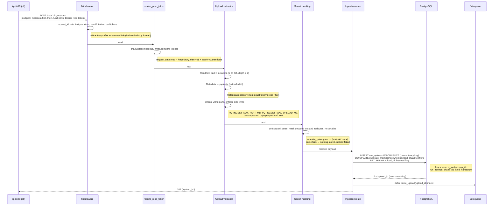
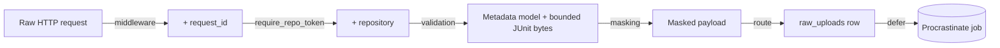
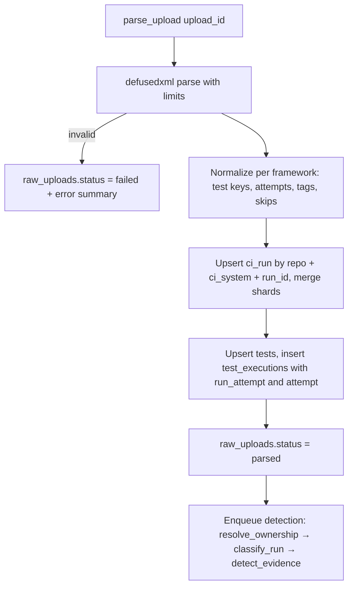
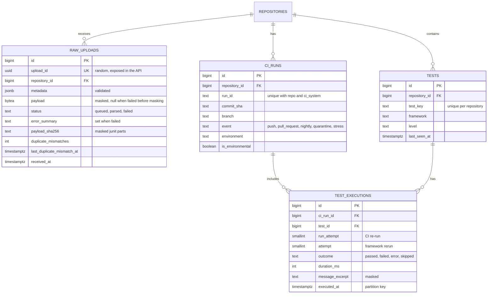

# CI Result Ingestion — Backend Flow (API → Database)

How one upload from a CI job becomes stored test results. Architecture: §8.1–8.3, §10, §13. Contract: `docs/contracts/ingestion.md`.

## Request Lifecycle

## Request Enrichment

## Error Responses

| Step | Cause | Status |
|------|-------|--------|
| Middleware | Too many requests for this repo token, or too many bad-token requests from this IP (trusted ingress hop) | 429 |
| `require_repo_token` | Missing, malformed, unknown or revoked token | 401 with `WWW-Authenticate: Bearer` |
| Validation | Metadata repository differs from the token's repository | 403 |
| Validation | Metadata, part or total size over limit, or decompressed size over cap | 413 |
| Validation | Metadata not first, repeated, gzipped, too deep or schema error; missing JUnit part; too many parts; invalid gzip (malformed XML is not a 400; see below) | 400 |
| Masking | JUnit part cannot be parsed for masking | 202, upload `failed`, nothing from the part stored |
| Route | Same idempotency key already stored | 202 with the first `upload_id`; a different `payload_sha256` increments `duplicate_mismatches` and alerts |
| Any | Unexpected error | 500, generic body, details in logs with `request_id` |

Parsing errors (bad XML structure, XXE attempts) never give a 400: the masking parse or the worker marks the upload `failed` and `GET /api/v1/ingest/runs/{upload_id}` shows the summary.

## After the Response (worker)

## Stored Data

