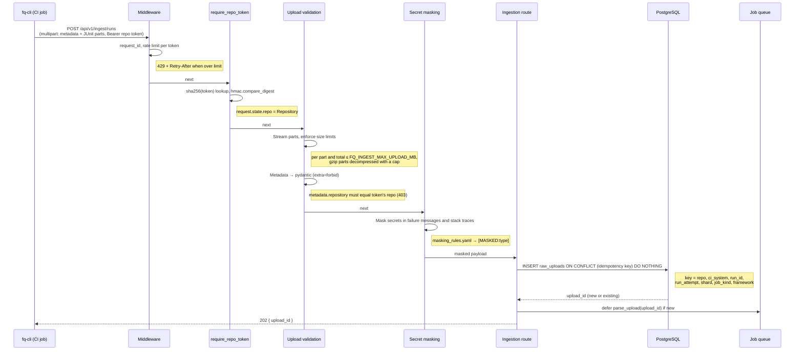
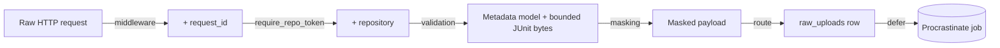
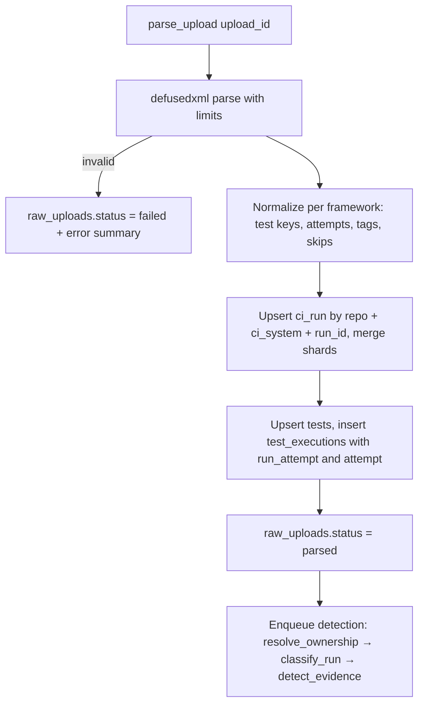
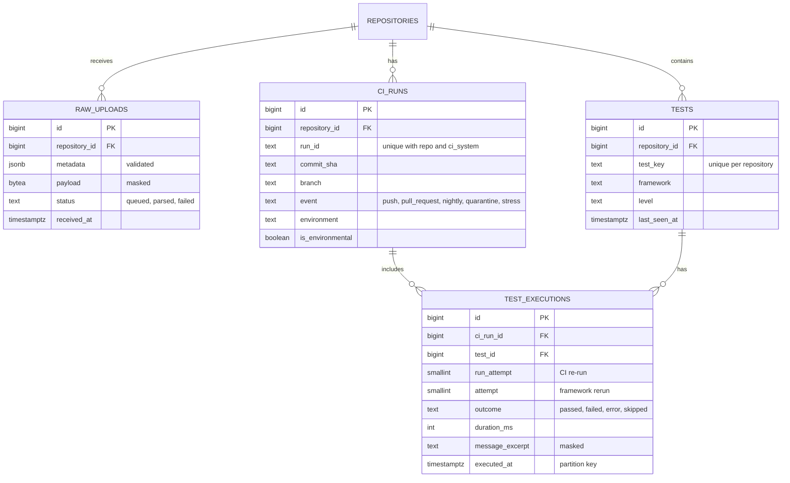

# CI Result Ingestion — Backend Flow (API → Database)

How one upload from a CI job becomes stored test results. Architecture: §8.1–8.3, §10, §13. Contract: `docs/contracts/ingestion.md`.

## Request Lifecycle

## Request Enrichment

## Error Responses

| Step | Cause | Status |
|------|-------|--------|
| Middleware | Too many requests for this repo token | 429 |
| `require_repo_token` | Missing, malformed or unknown token | 401 |
| Validation | Metadata repository differs from the token's repository | 403 |
| Validation | Part or total size over limit, or decompressed size over cap | 413 |
| Validation | Metadata schema error, missing JUnit part, not XML / gzip | 400 |
| Route | Same idempotency key already stored | 202 with the first `upload_id` |
| Any | Unexpected error | 500, generic body, details in logs with `request_id` |

Parsing errors (bad XML structure, XXE attempts) are found by the worker, not the route: the upload is marked `failed` and `GET /api/v1/ingest/runs/{upload_id}` shows the summary.

## After the Response (worker)

## Stored Data

